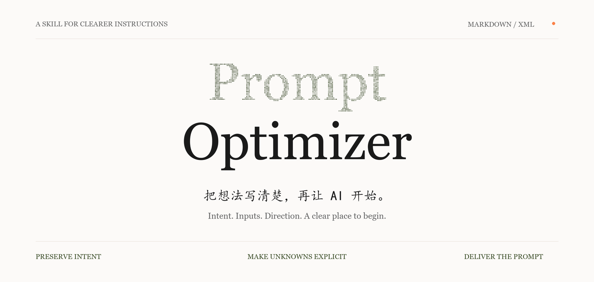

<p align="center">
  
</p>

<p align="center">
  <a href="#开始使用">开始使用</a> ·
  <a href="#选择方法">选择方法</a> ·
  <a href="prompt-optimizer/SKILL.md">阅读技能</a>
</p>

# Prompt Optimizer

把原始需求、草稿或现有 prompt，整理成可直接交给 AI 的提示词；后续追问沿用上下文，只处理新增要求。

这是一个以中文指令为主的 Codex skill。它在聊天中理解需求、处理缺项、选择合适的方法，交付提示词后停止。自然段、短清单、Markdown 和 XML 都可以使用。完整提示词默认让目标 AI 先核对材料、说明第一步，等待确认后开始；续改与后续追问沿用已有约定。

## 连续优化，不反复开场

| 你说 | 技能如何处理 |
| --- | --- |
| “帮我优化这个需求” | 按复杂度选择表达方式，不强制角色模板 |
| “语气再自然一点，只改这一段” | 沿用已确认设定，输出局部修改 |
| “帮我把追问写好：再举一个生活例子” | 输出可接在目标对话后的追问，不重复角色与背景 |
| “合并成完整最新版，我要发到新聊天” | 把已有约束和新增要求合并成自足的全文 |
| “记住这套，保存为 science-writing” | 将当前提示词和已确认设定写入本地具名档案 |
| “继续 science-writing，这次面向高中生” | 读取该档案，只调整本轮变化 |

例如，上一轮已经明确面向初中生解释科学概念，后续只需输出：

> 请补充一个初中生熟悉的生活例子，说明它与刚才概念的对应关系，并指出这个类比的适用边界。

同一聊天利用可见上下文；跨聊天通过实际文件恢复。默认档案位于 `~/.codex/prompt-optimizer-memory/`（设置了 `CODEX_HOME` 时使用其下同名目录），保存最新全文、确认项、未决项和修订编号，不随本仓库发布。新聊天需要指定档案名称，跨设备需要自行提供可访问的档案；没有文件工具时只能交付可携带摘要。具体规则见 [上下文与记忆](prompt-optimizer/references/context-memory.md)。

## 三个约定

| 保留原意 | 说明未知 | 交付清楚 |
| --- | --- | --- |
| 保留目标、受众、素材与硬约束，建议不冒充已确认要求。 | 缺少关键材料时提问或使用具名占位符，不编造事实、数据与偏好。 | 按任务选择结构，写清输出、验收和开始方式，交付可复制文本。 |

已有信息足够时直接优化；简单任务保持简洁。写作、研究、代码、视觉、分镜、学习与决策任务都可使用，方法和模块按需选择。

## 开始使用

把仓库中的整个 [`prompt-optimizer/`](prompt-optimizer/) 文件夹放到 Codex 的技能目录。默认位置为 `~/.codex/skills/`；Windows 对应 `%USERPROFILE%\.codex\skills\`。如果已设置 `CODEX_HOME`，使用其下的 `skills/` 目录。

保留 `agents/` 与 `references/`，已有同名技能时先比较再更新。你也可以在支持 skill-installer 的 Codex 会话中发送：

```text
$skill-installer
从 https://github.com/zuoyou12/prompt-optimizer 安装 prompt-optimizer 文件夹中的技能。
```

安装后，在下一轮会话中调用：

```text
$prompt-optimizer
优化下面的需求，输出 XML，采用反向拆解。
暂时不要追问，关键缺项保留占位符。

需求：为我的摄影作品做一个简洁的作品集网站。
```

也可以指定 Markdown、长度、分析方法和目标 AI 的启动方式。未指定格式时优先沿用适用的已有格式；简单任务用自然段或短清单，信息复杂时再使用 Markdown / XML。

## 一次优化的样子

以下是说明输出形态的示例，不是运行效果评测。

原始需求：为我的摄影作品做一个简洁的作品集网站。

```xml
<prompt>
  <role>你负责摄影作品集的信息组织、界面设计与实现。</role>
  <objective>让访客清楚浏览我的作品，并找到联系入口。</objective>
  <inputs>
    <required>{{摄影作品与使用权限}}</required>
    <required>{{作者介绍与公开联系方式}}</required>
    <required>{{技术环境与交付形式}}</required>
    <rule>不要编造作者经历、作品说明或联系方式。</rule>
  </inputs>
  <direction>优先突出照片，减少装饰；具体审美参考待我补充。</direction>
  <structure>作品浏览、作者介绍、联系入口；分类方式依据真实素材确定。</structure>
  <method>从浏览与联系的验收目标，倒推页面、素材和实现依赖。</method>
  <build>先核对技术环境，再提出路线；未经确认不锁定框架或部署服务。</build>
  <acceptance>作品可清楚浏览，手机布局可用，联系入口有效；未验证项如实说明。</acceptance>
  <start>先核对必要材料，简述理解和第一步，等待我的明确确认后执行。</start>
</prompt>
```

`role`、`inputs`、`direction`、`structure`、`build`、`gotchas`、`start` 等模块按任务选用，完整格式见 [输出骨架](prompt-optimizer/references/formats.md)。

## 选择方法

| 你遇到的问题 | 可选择的方法 |
| --- | --- |
| 目标还没想清楚 | 苏格拉底式提问 |
| 两种观点都有值得认真对待的理由 | 双向钢人论证 |
| 想重新检查机制、惯例或方案基础 | 第一性原理 |
| 需要跨对象、时间或层级比较 | 纵横分析 |
| 有目标产物，需要倒推条件与步骤 | 反向拆解 |
| 想提前找出计划容易失败的地方 | 失败预演 |
| 需要验证解释或区分竞争假设 | 假设检验与反证 |
| 多个方案需要权衡 | 决策比较 |
| 风格或格式很难说清楚 | 示例校准 |
| 交付有多个相互依赖的环节 | 分解、检查与修订 |

复杂任务通常采用一个主方法，必要时补一个检查方法。具体动作和适用边界见 [方法库](prompt-optimizer/references/methods.md)。

## 验收与边界

编程和评测类提示词按需限制跳过检查、放宽断言或降低标准的做法。研究和选型类提示词允许交付有依据的否定结论或不确定结果，并说明证据范围与剩余未知。用户已有详细规格时，优先准确引用，并确认目标 AI 能访问材料。

技能本轮只优化提示词，不执行原任务。用户明确要求最终提示词采用直接执行、单轮回答等方式时，可调整其启动规则。

技能没有内置模型调用或效果评测平台；本地档案保存最新快照和修订编号，不提供完整版本历史或云同步。输出更清晰不等于效果已获证明；实际表现取决于模型、输入材料和任务，需通过实际案例检验。

## 文件

```text
prompt-optimizer/
├── SKILL.md                 核心规则与任务路由
├── agents/openai.yaml       技能显示信息
└── references/
    ├── context-memory.md    具名档案的本地保存与恢复
    ├── methods.md           按需读取的方法库
    └── formats.md           Markdown / XML 骨架
```

## 设计与参考

仓库封面采用暖白纸色、衬线字、留白与橄榄绿点缀，参考提供的 MiMo 风格说明，用静态图适配 GitHub README。

验收规则参考了 [khazix-skills / leader](https://github.com/KKKKhazix/khazix-skills/tree/main/leader) 中关于验收完整性、探索型交付和已有规格的思路，按本技能范围重新表达。

本仓库与 [linshenkx / prompt-optimizer](https://github.com/linshenkx/prompt-optimizer) 是不同项目；此处提供的是聊天内使用的技能规则。
